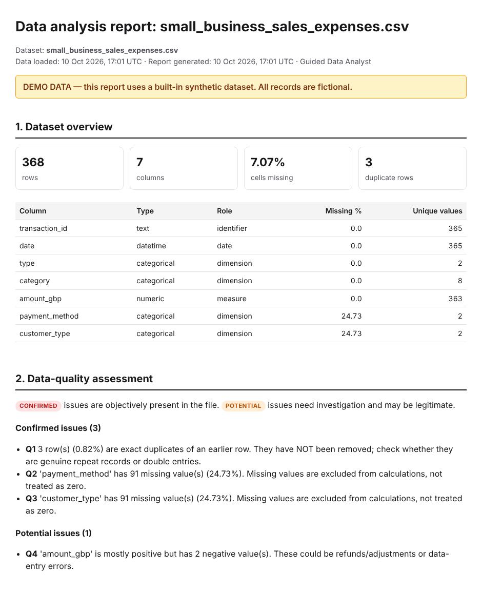
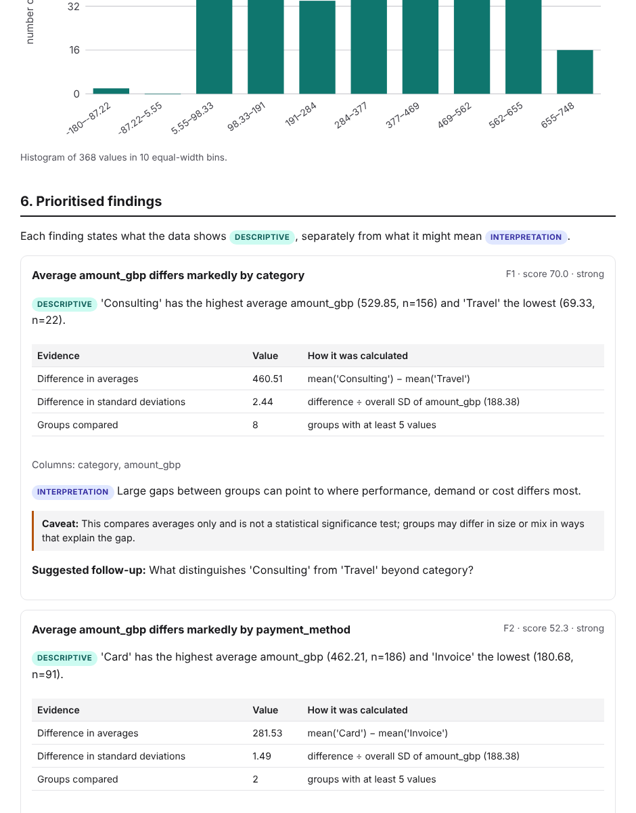

# Guided Data Analyst

> Upload your data, understand what it contains, discover what matters, and receive a report you can trust.

A web app that takes a CSV or Excel file and walks you through a complete analysis — **profile → explore → discover → report** — without writing Python, SQL or Excel formulas. Every number comes from deterministic, tested code; every finding shows the evidence behind it and its limitations.

Built as a learning and portfolio project: Next.js + TypeScript on the front, FastAPI + pandas on the back.



## What it does

| Stage | What you get |
|---|---|
| **1. Upload** | CSV or `.xlsx` (with worksheet picker), drag-and-drop, three labelled demo datasets, a preview of the raw rows, and a list of every change made while reading the file |
| **2. Profile** | Rows, columns, inferred types and roles, missing values, duplicates, unique counts, numeric summaries, category frequencies, date ranges — and data-quality issues split into **confirmed** (objectively true) and **potential** (worth investigating) |
| **3. Explore** | Distributions (histogram + box plot with outlier fences), category frequencies, trends over time with partial-period warnings, group comparisons, correlation heatmap and scatter plots. Only analyses that suit each column's type are offered |
| **4. Discover** | A rule-based findings engine: trends, concentration, group differences, associations, missing-data risk, duplicates, outliers. Each finding has evidence, a caveat and a follow-up question, and is ranked by a published formula. If nothing meets a threshold, it says so |
| **5. Report** | A self-contained HTML report (print to PDF from the browser) and CSV exports of every table |

Optional: a plain-English **AI explanation** of the findings. Off by default, needs your own API key, asks for consent, never sends raw rows, and validates the reply against the finding IDs and evidence.



## Quick start

**Requirements:** Python 3.11+, Node.js 22+ (for `npm test`, 22.6+), npm.

```bash
git clone https://github.com/oscar-onavwie/Guided-Data-Analyst.git
cd Guided-Data-Analyst
```

**1. Backend** (terminal 1)

```bash
cd backend
python -m venv .venv
source .venv/bin/activate          # Windows: .venv\Scripts\activate
pip install -r requirements-dev.txt
uvicorn app.main:app --reload --port 8000
```

The API is now at http://localhost:8000 (interactive docs at http://localhost:8000/docs).

**2. Frontend** (terminal 2)

```bash
cd frontend
npm install
cp .env.example .env.local         # sets NEXT_PUBLIC_API_URL=http://localhost:8000
npm run dev
```

Open http://localhost:3000 and click **Load demo** on any of the three datasets to see the whole journey.

## Configuration

Backend settings are environment variables (all optional); see [`.env.example`](.env.example). To use a file: `uvicorn app.main:app --env-file ../.env`.

| Variable | Default | Purpose |
|---|---|---|
| `MAX_UPLOAD_MB` / `MAX_ROWS` / `MAX_COLUMNS` / `MAX_CELLS` | 20 / 200,000 / 200 / 5,000,000 | Upload limits |
| `SESSION_TTL_MINUTES` / `MAX_SESSIONS` | 30 / 20 | How long datasets stay in memory, and how many |
| `ALLOWED_ORIGINS` | `http://localhost:3000,…` | Frontend URLs allowed to call the API |
| `AI_ENABLED` + `ANTHROPIC_API_KEY` | off | Turn on optional AI explanations (both required) |
| `AI_MODEL` | `claude-sonnet-5-5` | Model used for explanations |
| `NEXT_PUBLIC_API_URL` (frontend) | `http://localhost:8000` | Where the browser reaches the API |

## Testing

```bash
# Backend: 129 tests — parsing, type inference, statistics checked against hand calculations,
# findings from planted patterns, reports/exports, AI validation (mocked), and the HTTP API
cd backend && pytest -q && ruff check . && ruff format --check .

# Frontend: unit tests, type check, lint, production build
cd frontend && npm test && npm run typecheck && npm run lint && npm run build
```

GitHub Actions runs all of the above on every push ([`.github/workflows/ci.yml`](.github/workflows/ci.yml)).

## Project structure

```
backend/
  app/
    main.py         FastAPI routes, upload limits, error handling, security headers
    service.py      Orchestration and per-dataset caching (framework-independent)
    parsing.py      CSV/XLSX reading and validation
    inference.py    Column types (number, date, category…) and roles
    profiling.py    Dataset profile and confirmed/potential data-quality issues
    analysis.py     Statistics, time series, correlation, group comparison
    findings.py     Deterministic findings engine and ranking
    reports.py      HTML report + CSV exports (templates/report.html.j2)
    ai.py           Optional, validated AI explanations
    store.py        In-memory dataset sessions with expiry
  tests/            pytest suite
frontend/
  src/app/          Next.js App Router entry
  src/components/   Workspace, stage screens, charts, UI kit
  src/lib/          Typed API client, shared types, formatting helpers
sample-data/        Synthetic demo datasets (+ README of planted patterns)
scripts/            Sample-data generator
docs/               Architecture, methodology, API reference, OpenAPI spec
```

## Documentation

- [Architecture and data flow](docs/architecture.md) — components, request flow, security, deployment path
- [How the analysis works](docs/methodology.md) — every rule, threshold and formula
- [API reference](docs/api.md) — endpoints and error codes
- [Sample datasets](sample-data/README.md) — the planted patterns and expected results

## Data handling

Files are processed in memory and never written to disk by the app. A dataset stays in server memory for 30 minutes after its last use (configurable), until you click **Remove**, or until the server restarts. Raw values are never logged. **Use non-sensitive data only:** this project has no authentication or encryption at rest and is not suitable for confidential, personal or patient data.

## Known limitations

- One dataset at a time; no joins across files or worksheets.
- In-memory storage: data is lost on restart and the backend must run as a single process.
- Findings use fixed thresholds and compare averages; there are no significance tests or confidence intervals.
- Type inference is heuristic (95% rule). An unusual column can be misclassified; the profile shows what was inferred and why.
- Dates are read day-first when ambiguous (UK convention); there is no per-column override yet.
- PDF export relies on the browser's *Print → Save as PDF*.
- `.xls`, `.xlsm` and Excel formulas without saved values are not supported.

## Future improvements

- Let users override a column's inferred type or date order and re-run the analysis.
- Significance tests (e.g. Welch's t-test, chi-square) and confidence intervals on findings.
- Server-side PDF generation.
- Persistent, authenticated workspaces (Redis/Postgres) for multi-user deployment.
- Browser-level end-to-end tests (Playwright) of the full upload-to-report journey.

## Licence

MIT — see [LICENSE](LICENSE). All sample data is synthetic.
