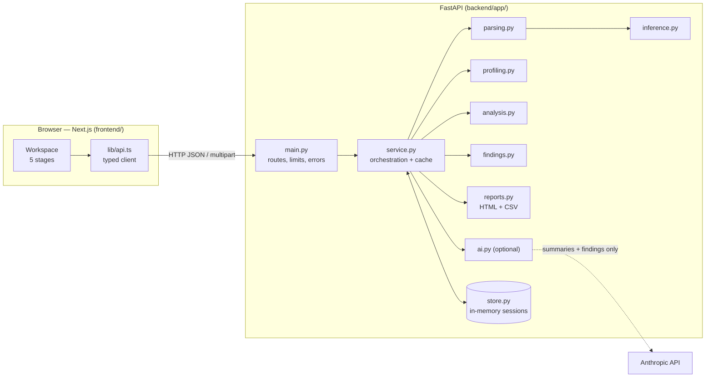

# Architecture and data flow

## Request flow

1. **Upload** – the browser posts the file (multipart) to `POST /api/datasets`. For `.xlsx` it first calls `POST /api/files/sheets` and asks the user to pick a worksheet if there is more than one.
2. `parsing.py` validates type, size and shape, and reads every cell as text. `inference.py` assigns each column a type and role.
3. The parsed table is stored in `store.py` under a random 128-bit id. Nothing touches the disk.
4. **Profile / Explore / Discover** – the browser requests `/profile`, `/analysis` and `/findings`. Each is computed once per dataset and cached in the session. Interactive charts (`/explore/grouped`, `/scatter`, `/timeseries`) are computed on demand.
5. **Report** – `/report.html` and `/export/{table}.csv` render from the same cached objects, so an export cannot disagree with the screen.
6. **AI (optional)** – only if enabled on the server *and* the user ticks a consent box. `ai.py` sends column names/types, row counts and the findings with evidence (never raw rows), validates the JSON reply, drops references to unknown finding ids, and flags numbers that are not in the evidence.

## Key decisions

| Decision | Why |
|---|---|
| Logic in `service.py`, FastAPI only in `main.py` | Analysis can be tested without a web server (most tests do this) and the framework could be swapped |
| Read everything as text, then infer types | Full control over blanks, currency, percentages and dates; nothing is silently coerced to 0 |
| In-memory sessions, no database | The brief asks for temporary handling only. Trade-off: data is lost on restart and the server is single-process; see *Deployment* below |
| Server-side SVG in the report | The exported HTML works offline and contains no JavaScript |
| Frontend calls the API directly (CORS) | Avoids proxy body-size limits on uploads; allowed origins are configured with `ALLOWED_ORIGINS` |
| Recharts in the app, custom SVG box plot | Recharts has no box-plot primitive |

## Security and data handling

- Upload limits enforced twice: by `Content-Length` before the body is read, and by counting bytes while reading.
- File names are reduced to their last path component and used for display only; demo files come from a fixed allow-list, so URL input never builds a path.
- `.xlsx` must be a real ZIP containing a workbook; expanded size is capped (ZIP-bomb guard). Formulas and macros are never evaluated.
- Errors return a stable JSON shape `{error: {code, message, details}}`; unexpected exceptions are logged by type only, so cell values never reach logs.
- Responses carry `X-Content-Type-Options: nosniff`, `Referrer-Policy: no-referrer` and `Cache-Control: no-store`; the HTML report adds a CSP that blocks scripts and external requests.
- Reports are rendered with Jinja2 auto-escaping (a test injects `<script>` in headers and file names).
- **Retention:** data lives in server memory for `SESSION_TTL_MINUTES` after last use (default 30), at most `MAX_SESSIONS` datasets, or until the user clicks *Remove* or the server restarts. Starlette may spool uploads larger than 1 MB to a temporary file while the request is being read; it is deleted when the request ends.
- **Not suitable for confidential, personal or patient data** without further work (authentication, encryption, audit, DPIA).

## Deployment path

The app is designed for local use first. To deploy:

1. Backend: run `uvicorn app.main:app --host 0.0.0.0 --workers 1` in a container (one worker, because sessions live in process memory). For several workers, move `store.py` to Redis or similar.
2. Frontend: `npm run build && npm start`, or deploy to any Next.js host, with `NEXT_PUBLIC_API_URL` pointing at the backend.
3. Set `ALLOWED_ORIGINS` to the frontend's URL and put both behind HTTPS.
4. Add authentication before accepting real users' data.
